# Dziennik elektroniczny

Aplikacja webowa symulująca elektroniczny dziennik szkolny. Projekt portfolio, w którym ćwiczę i prezentuję umiejętności fullstack .NET developera. Gotowy jest panel administracyjny (użytkownicy, role, hierarchia uprawnień); moduły ucznia, klas i planu zajęć mają na razie tylko dane startowe i strukturę bazy.

## O projekcie

System zarządzania użytkownikami i rolami w środowisku szkolnym z wielopoziomową hierarchią uprawnień (SuperAdmin, Admin, Dyrektor, ViceDyrektor, Sekretarka, Nauczyciel, Rodzic, Uczeń). Projekt kładzie nacisk na bezpieczeństwo dostępu do danych i na rozdzielenie odpowiedzialności między warstwami aplikacji.

## Stack technologiczny

- **Backend:** ASP.NET Core MVC (.NET 10)
- **Baza danych:** MySQL, EF Core 9 (Pomelo.EntityFrameworkCore.MySql)
- **Uwierzytelnianie i autoryzacja:** ASP.NET Core Identity
- **Web API:** kontroler REST dla ról (`/api/role`), błędy w formacie ProblemDetails
- **Testy:** xUnit, Moq
- **Architektura:** podział na warstwy Domain / Application / Infrastructure / Controllers / Views

## Jak uruchomić projekt

**Wymagania:** .NET 10 SDK, MySQL Server, narzędzie `dotnet-ef`.

1. Sklonuj repozytorium.
2. W `Dziennik szkolny/appsettings.json` ustaw `ConnectionStrings:DefaultConnection`. Wartość domyślna wskazuje lokalny serwer (`server=localhost;port=3306;database=dziennik;user=root;password=`) i jest przeznaczona wyłącznie do środowiska deweloperskiego.
3. Utwórz schemat bazy z migracji: `dotnet ef database update --project "Dziennik szkolny"`.
4. Uruchom aplikację: `dotnet run --project "Dziennik szkolny"`. Przy pierwszym starcie na pustej bazie aplikacja zasila ją danymi startowymi; przy kolejnych startach dane startowe nie są ponownie dodawane.
5. Zaloguj się jednym z kont demonstracyjnych (niżej).

## Konta demonstracyjne

Konta tworzone przez seed: `SuperAdmin`, `Admin`, `Dyrektor`, `ViceDyrektor`, `Sekretarka`, `Nauczyciel1`, `Nauczyciel2`, `Nauczyciel3`, `Rodzic1`, `Rodzic2`, `Rodzic3`. Wszystkie mają to samo hasło demonstracyjne (stała w `DaneStartowe.cs`, spełnia reguły siły hasła); aktualne dane są w pliku `Dane logowania do systemu.txt`. To konta wyłącznie pokazowe; w prawdziwym systemie konta administracyjne powinny być imienne (zob. niżej).

Konto `Nauczyciel1` ma role Nauczyciel i Rodzic, jest wychowawcą klas A i B, prowadzi polski i matematykę oraz jest opiekunem ucznia, więc na tym koncie widać wszystkie blokady zmiany ról i usuwania.

## Funkcjonalności

- Logowanie z przekierowaniem do strony, o którą użytkownik pierwotnie prosił (`ReturnUrl`, tylko adresy lokalne).
- Blokada konta po 5 nieudanych próbach na 5 minut; komunikat podaje godzinę końca blokady w czasie polskim.
- Panel administracyjny: dodawanie, edycja i usuwanie użytkowników oraz dodawanie, zmiana nazwy i usuwanie ról. Panel użytkowników jest dostępny dla SuperAdmina, Admina, Dyrektora i ViceDyrektora, a zarządzanie rolami tylko dla Admina.
- Hierarchiczny model uprawnień: użytkownik widzi i zarządza tylko osobami, których role są mu podporządkowane w hierarchii (widoczność: co najmniej jedna rola podległa, zarządzanie: wszystkie role podległe).
- Walidacja danych użytkownika: m.in. suma kontrolna numeru PESEL, telefon, unikalność loginu, e-maila i numeru PESEL.
- Reguły haseł: co najmniej 8 znaków, cyfra, mała i wielka litera oraz znak specjalny. Reguły są zapisane w jednym miejscu (`Domain/reguly/OgraniczeniaHasla.cs`) i używane przez konfigurację Identity, walidację i widoki.
- Reguły nazw ról: po przycięciu 2–50 znaków, słowa łączone bez spacji i pisane wielką literą (np. „it specjalista” daje „ItSpecjalista”), duplikaty odrzucane. Do limitu 50 znaków liczą się też spacje wewnątrz nazwy (przycinane są tylko brzegi), np. „a b” ma 3 znaki i daje „AB”. Role systemowe z danych startowych nie mogą być usunięte ani przemianowane. Nie można też usunąć roli, która uczestniczy w hierarchii poza relacją z rolą Admin, ani roli będącej jedyną rolą jakiegoś użytkownika.
- Web API ról dla Admina: lista zarządzanych ról, odczyt roli po Id, dodawanie i usuwanie roli z tymi samymi regułami co w panelu (opis w sekcji „Web API ról”).
- Reguła ostatniego administratora: nie można usunąć jedynego użytkownika z rolą Admin.
- Ochrona powiązań użytkownika: nie można usunąć użytkownika, który jest opiekunem ucznia, prowadzi przedmiot albo jest wychowawcą klasy. W edycji nie można odebrać roli Rodzic opiekunowi ucznia ani roli Nauczyciel nauczycielowi, który prowadzi przedmiot lub jest wychowawcą. Zmiana samych danych i dodawanie ról są dozwolone.

## Bezpieczeństwo

Celem było praktyczne zastosowanie zasad bezpiecznego dostępu do danych (broken access control, OWASP):

- kontrola dostępu na poziomie zasobu, nie tylko roli, przy podglądzie, edycji i usuwaniu użytkowników
- ochrona przed podniesieniem uprawnień: użytkownik nie przypisze roli spoza swojego zakresu
- token anty-CSRF na logowaniu i na akcjach zmieniających dane w panelu administracyjnym
- ochrona przed open redirect (`Url.IsLocalUrl` + `LocalRedirect`)
- blokada konta i wymagania siły hasła włączone w konfiguracji Identity

**Świadome kompromisy:**

- Komunikat o blokadzie konta ujawnia, że takie konto istnieje, i pozwala celowo zablokować cudze konto. To kompromis na rzecz czytelności dla użytkownika.
- Konto `SuperAdmin` jest chronione przez hierarchię: żadna rola nim nie zarządza, a rolą `Admin` zarządza tylko `SuperAdmin`.
- Akcja wylogowania nie wymaga tokenu anty-CSRF. Skutkiem takiego ataku byłoby wyłącznie wymuszone wylogowanie użytkownika, bez dostępu do konta lub danych.
- Ochrona przed bezpośrednią edycją bazy danych jest poza zakresem aplikacji (wymaga dostępu do całego systemu); właściwą odpowiedzią są logi działań administratorów.

**Zasada kont administracyjnych.** Konta administracyjne powinny być oddzielone od kont codziennych, imienne (a nie wspólne), z rozdzieleniem obowiązków (`SuperAdmin` zarządza administratorami, `Admin` rolami szkolnymi) i z niezależnością awaryjną (reguła ostatniego administratora). Wspólne konta `Admin` i `SuperAdmin` w danych startowych są wyjątkiem demonstracyjnym.

## Web API ról

Kontroler `RoleApiController` (`/api/role`) udostępnia zarządzanie rolami przez REST. Wymaga zalogowania z rolą Admin (ciasteczko Identity `.AspNetCore.Identity.Application`).

| Metoda | Adres | Opis | Odpowiedzi |
|---|---|---|---|
| GET | `/api/role` | lista ról, którymi zarządza zalogowany Admin | 200, 401 |
| GET | `/api/role/{id}` | rola po Id | 200, 404, 401 |
| POST | `/api/role` | dodanie roli, ciało: `{"nazwa":"it specjalista"}` | 201 (nagłówek `Location`, treść `{id, nazwa}`), 400, 409, 401 |
| DELETE | `/api/role/{id}` | usunięcie roli | 204, 404, 409, 401 |

Zasady odpowiedzi:

- 401: brak uwierzytelnienia (bez ciasteczka). Inna rola niż Admin (np. SuperAdmin) dostaje 403, co wynika z atrybutu `[Authorize(Roles = Admin)]` i nie było sprawdzane ręcznie.
- 400: nazwa nie spełnia reguł (2 do 50 znaków po przycięciu, pole wymagane); walidacja modelu zatrzymuje żądanie, zanim wykona się logika serwisu.
- 404: rola nie istnieje lub nie jest zarządzana przez zalogowanego Admina (rola spoza zakresu jest ukrywana, nie ujawniamy jej istnienia).
- 409: konflikt biznesowy (rola o takiej nazwie już istnieje, rola systemowa, rola będąca jedyną rolą użytkownika, rola w hierarchii).
- Nazwa roli jest normalizowana tak jak w panelu („it specjalista” daje `ItSpecjalista`, „NOWA” daje `Nowa`, „nowaRola” daje `NowaRola`); odpowiedź 201 zawiera nazwę faktycznie zapisaną.
- Błędy mają format ProblemDetails (RFC 9110).

Przykład wywołania (w PowerShellu `curl.exe`; wartość ciasteczka z przeglądarki, zakładka Application, po zalogowaniu jako Admin; nie zapisywać jej w repozytorium):

```
curl.exe -k -i -H "Cookie: .AspNetCore.Identity.Application=WARTOSC" https://localhost:7100/api/role
```

Ciasteczko wygasa po 5 minutach bezczynności. Zmiana hasła lub ról użytkownika unieważnia jego sesję, więc po takiej zmianie trzeba zalogować się ponownie i użyć nowej wartości ciasteczka.

Testy ręczne (`curl`, localhost, 11.11.2026), wszystkie zgodne z oczekiwaniem:

| Przypadek | Wynik |
|---|---|
| POST `it specjalista` / `NOWA` / `nowaRola` | 201, zapisane `ItSpecjalista` / `Nowa` / `NowaRola` |
| POST ` a ` / pusta nazwa | 400 (walidacja `NoweDaneRoli`), rola nie powstaje |
| POST duplikat (także `ITSPECJALISTA`) | 409 „Rola o takiej nazwie już istnieje.” |
| GET rola po Id / nieistniejący Id / rola poza zakresem Admina | 200 / 404 / 404 |
| DELETE roli | 204; ponownie ten sam Id: 404 |
| DELETE roli systemowej | 409 „Nie można usunąć roli, która jest systemowa.” |
| DELETE roli będącej jedyną rolą użytkownika | 409 „Nie można usunąć roli, która jest jedyną rolą użytkownika.” |
| dowolne żądanie bez ciasteczka | 401 |

## Architektura

Podział na warstwy (Domain, Application, Infrastructure) inspirowany Clean Architecture, z rozdzieleniem logiki biznesowej od kontrolerów oraz wzorcem Unit of Work do zarządzania transakcjami. Niektóre uproszczenia zastosowano świadomie, aby projekt pozostał czytelny jako materiał demonstracyjny. Największe z nich: ASP.NET Core Identity (`LoginUzytkownika`) jest używane bezpośrednio w Domain i Application zamiast własnego modelu użytkownika mapowanego w Infrastructure, więc zależności nie są w pełni odwrócone; w jednym projekcie, z Identity jako podstawą logowania, uznałem to za rozsądny kompromis.

## Dane startowe

Przy starcie aplikacja sprawdza, czy w bazie są użytkownicy. Jeśli ich nie ma, w jednej transakcji zasila bazę rolami systemowymi, hierarchią uprawnień, kontami demonstracyjnymi, klasami, uczniami, przedmiotami i planem zajęć; błąd w trakcie cofa całość, więc kolejny start spróbuje ponownie. Jeśli użytkownicy już istnieją, dane startowe nie są dodawane, więc zmiany wprowadzone w panelu (usunięte konta, zmienione role) nie są cofane przy restarcie. Skutek: nowe dane startowe dodane w kodzie trafiają tylko do świeżej bazy (`dotnet ef database drop`, potem `update`).

## Hierarchia ról

Kto kim zarządza (relacje przechowywane w bazie jako para rola zarządzająca → rola zarządzana):

| Rola | Może zarządzać rolami |
|---|---|
| SuperAdmin | Admin |
| Admin | Dyrektor, ViceDyrektor, Sekretarka, Nauczyciel, Rodzic |
| Dyrektor | Sekretarka, Nauczyciel, Rodzic |
| ViceDyrektor | Sekretarka, Nauczyciel, Rodzic |
| Sekretarka | Uczeń, Rodzic |
| Nauczyciel, Rodzic, Uczeń | nikim |

Szczegółowy opis jest w pliku `Hierarchia.txt` w katalogu głównym repozytorium.

## Testy

Testy jednostkowe (xUnit, Moq) obejmują walidację danych użytkownika (w tym siłę hasła i PESEL) oraz serwis zarządzania rolami: zmianę nazwy, dodawanie (wykrywanie duplikatów, normalizacja nazwy, granice długości 2 i 50 znaków) i usuwanie (odmowy: rola nieistniejąca, systemowa, mająca powiązania w hierarchii, jedyna rola użytkownika). Dwa testy pomyślnego i nieudanego usunięcia roli są pominięte, bo wymagają bazy w pamięci. Web API ról sprawdzono ręcznie (tabela w sekcji „Web API ról”); nie ma testów automatycznych kontrolera.

## Znane ograniczenia

- Reguły ochrony powiązań użytkownika (opiekun, przedmiot, wychowawca) oraz reguła ostatniego administratora są zapisane w kontrolerze i nie mają testów jednostkowych.
- Brak edycji własnego hasła i podglądu własnych danych (planowane).
- Rola Sekretarka nie ma jeszcze dostępu do panelu użytkowników; jej panel (zarządzanie Uczniem i Rodzicem) jest planowany, na stronie głównej widzi na razie pusty panel.
- Logowanie błędów (`ILogger`) jest tylko w obsłudze użytkownika; brak logów działań administratorów i odmów.
- Brak testów dla reguł widoczności i zarządzania (Any/All) oraz dla usuwania ról powiązanych z hierarchią.
- Panel nie pozwala tworzyć relacji hierarchii między rolami; powstają one tylko z danych startowych.
- Po zmianie hasła lub ról użytkownika jego sesja jest unieważniana; walidacja stempla zabezpieczeń odbywa się przy każdym żądaniu, co dodaje zapytania do bazy (kompromis na korzyść bezpieczeństwa w projekcie demonstracyjnym).
- Dane startowe, w tym konta demonstracyjne ze wspólnym hasłem, są dodawane do każdej pustej bazy, w każdym środowisku (także produkcyjnym); aktualizacja bazy po zmianie danych startowych wymaga jej odtworzenia.
- Web API ról nie ma testów automatycznych (tylko ręczne zapytania `curl`); odpowiedź 403 dla roli innej niż Admin wynika z atrybutu autoryzacji i nie była sprawdzana ręcznie.

## Planowane dalsze prace

**Techniczne:**
- testy Any/All i usuwania ról z bazą w pamięci
- logi działań administratorów i odmów dostępu
- ujednolicenie sprawdzania powiązań użytkownika (opiekun, przedmiot, wychowawca) w jednym miejscu dla edycji i usuwania oraz przeniesienie tych reguł do serwisu z testami jednostkowymi

**Funkcjonalne:**
- edycja własnego hasła i podgląd własnych danych
- panel Sekretarki: zarządzanie Uczniem i Rodzicem
- dodanie ucznia, klas i łączenie nauczycieli z klasami
- plan zajęć

## Zrzuty ekranu

Wszystkie zrzuty pochodzą z danych demonstracyjnych.

### Logowanie i strony główne według ról

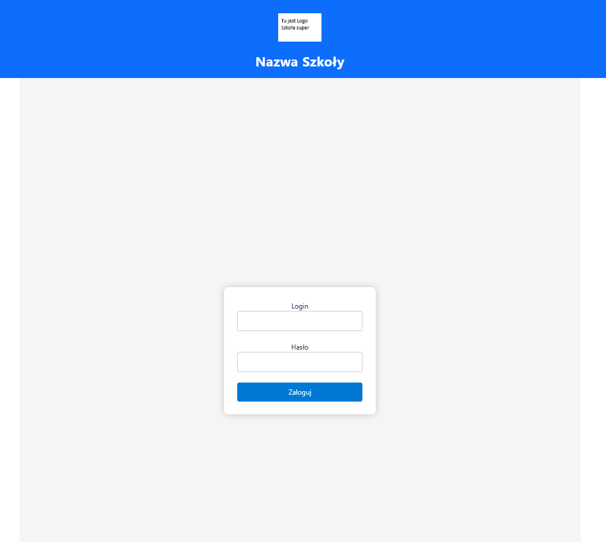
*Ekran logowania.*

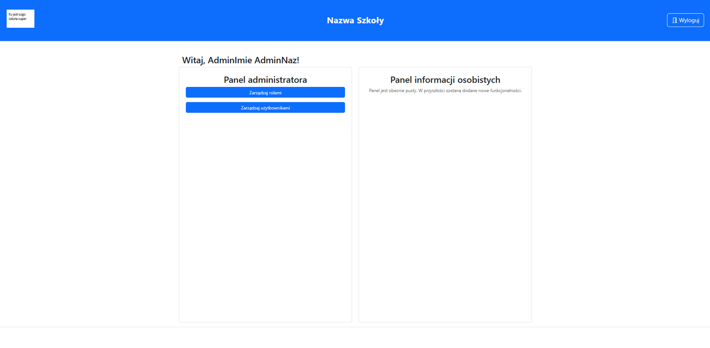
*Strona główna Admina: panel administratora z zarządzaniem rolami i użytkownikami.*

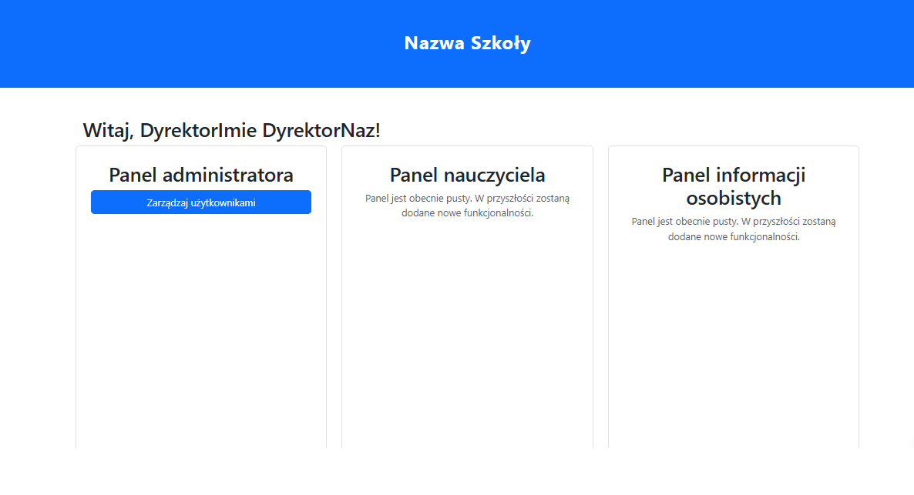
*Strona główna Dyrektora (identycznie ViceDyrektora): zarządzanie użytkownikami bez zarządzania rolami.*

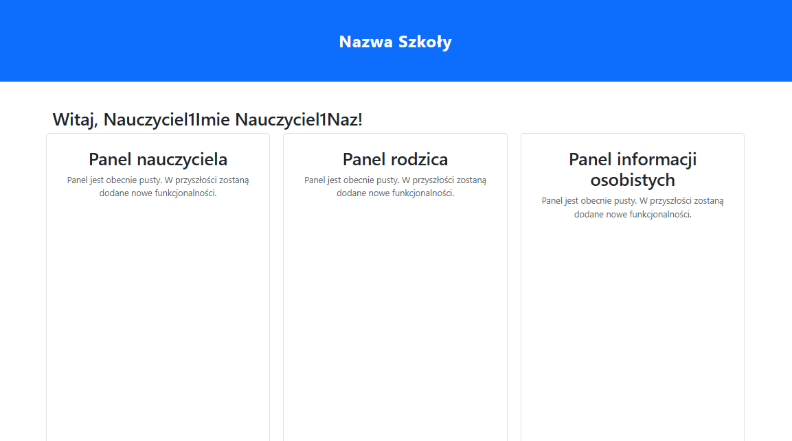
*Użytkownik z dwiema rolami widzi panele obu.*

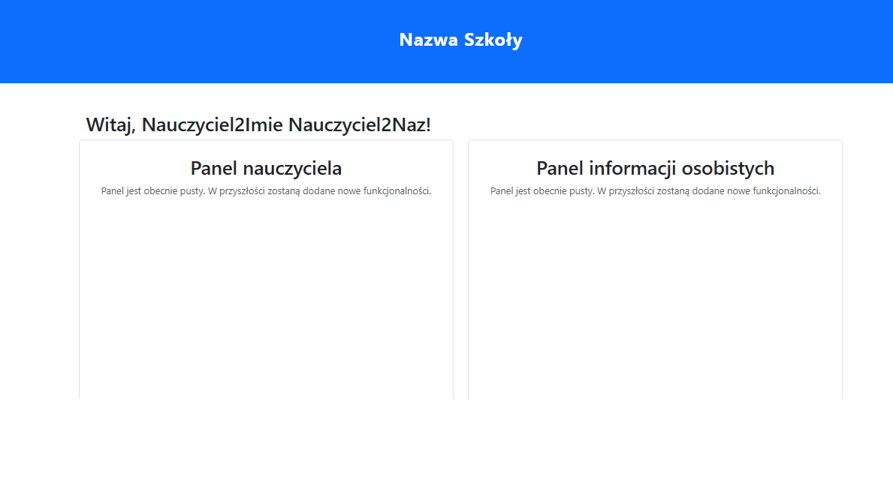
*Strona główna Nauczyciela.*

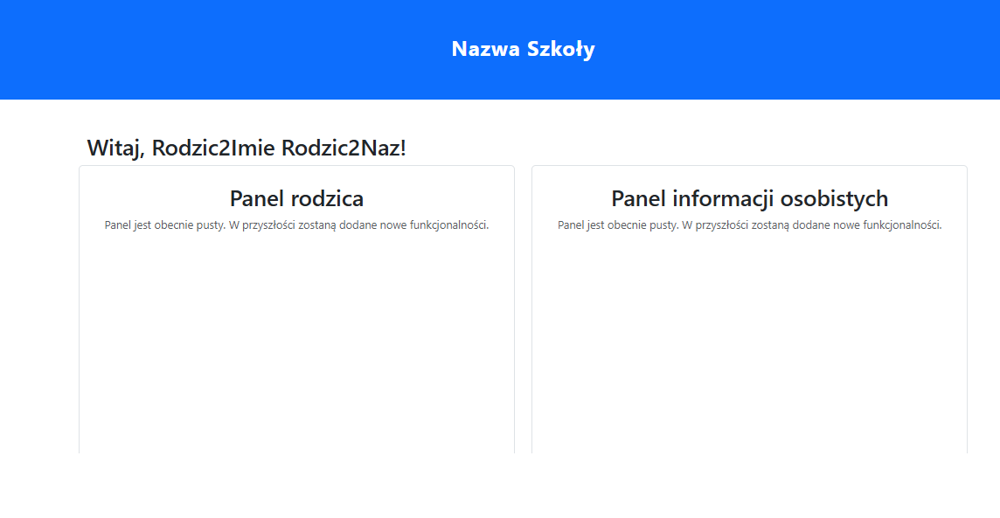
*Strona główna Rodzica.*

### Zarządzanie rolami (Admin)

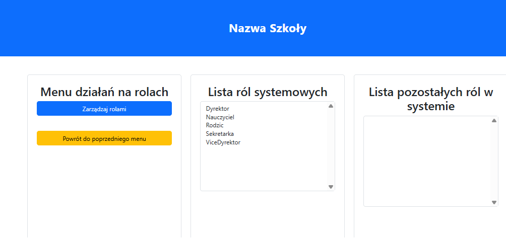
*Lista ról systemowych i pozostałych.*

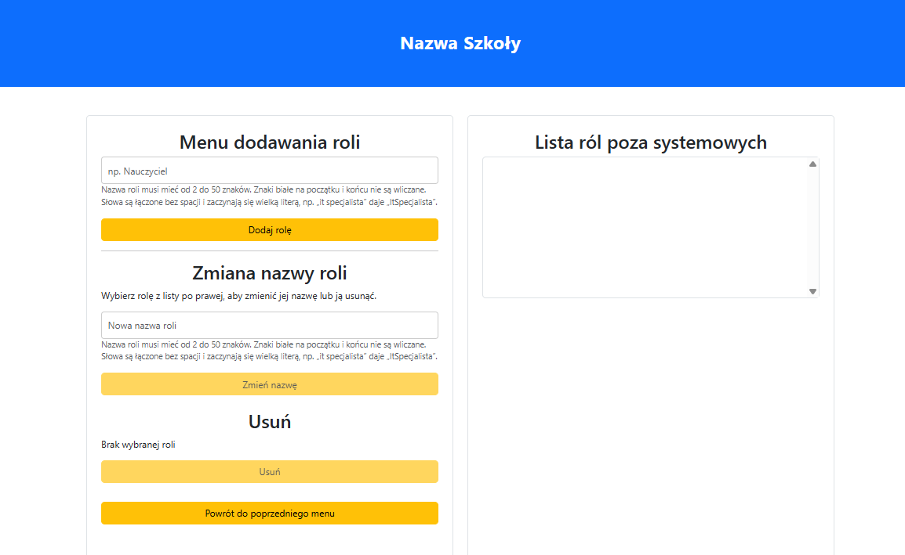
*Dodawanie, zmiana nazwy i usuwanie ról spoza systemowych, z podpowiedzią reguł nazw.*

### Zarządzanie użytkownikami

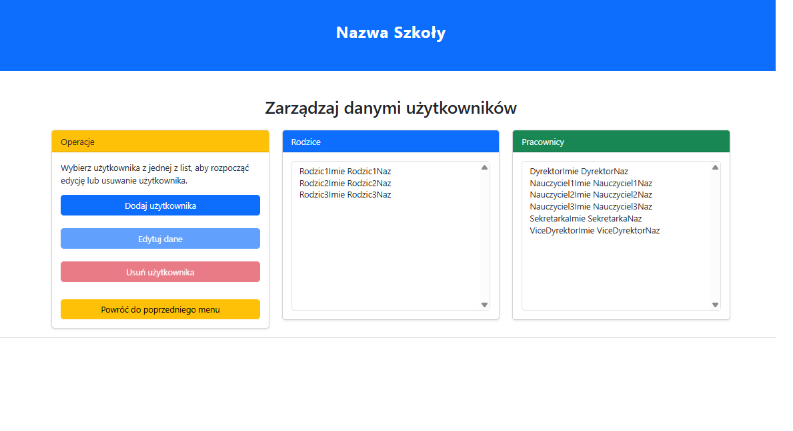
*Widok Admina: wśród pracowników widoczni są także Dyrektor i ViceDyrektor.*

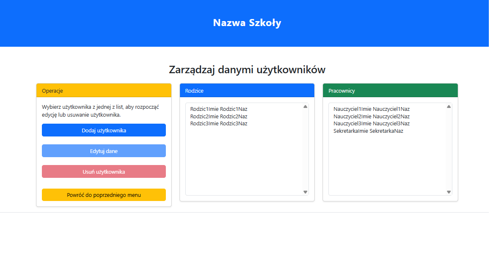
*Widok Dyrektora: tylko role mu podległe, bez Dyrektora, ViceDyrektora i Admina.*

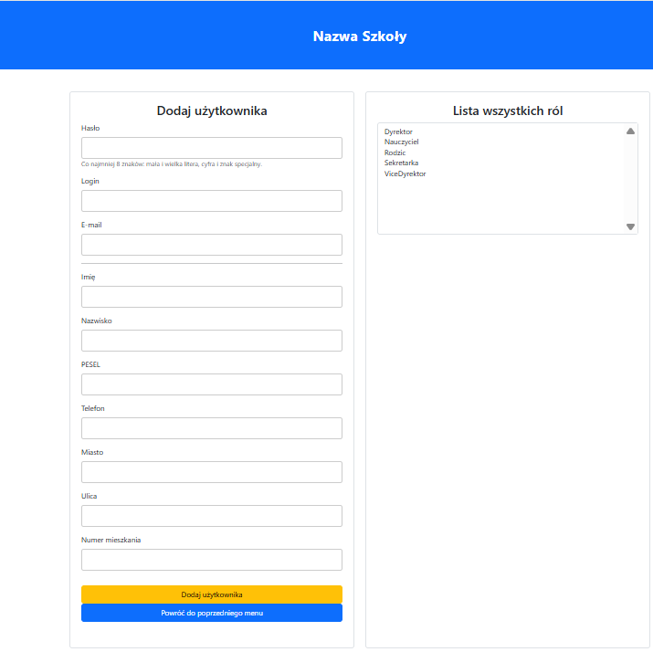
*Dodawanie użytkownika; lista ról zawiera tylko role, którymi zalogowany użytkownik może zarządzać.*

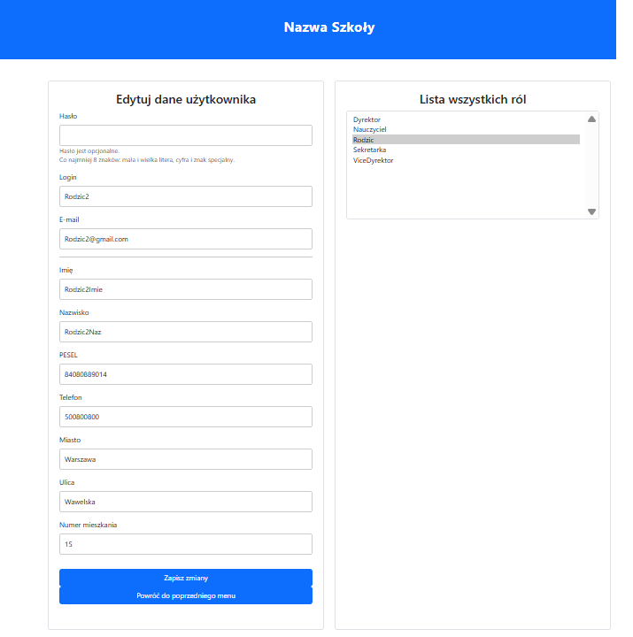
*Edycja użytkownika z opcjonalną zmianą hasła i zaznaczonymi rolami.*

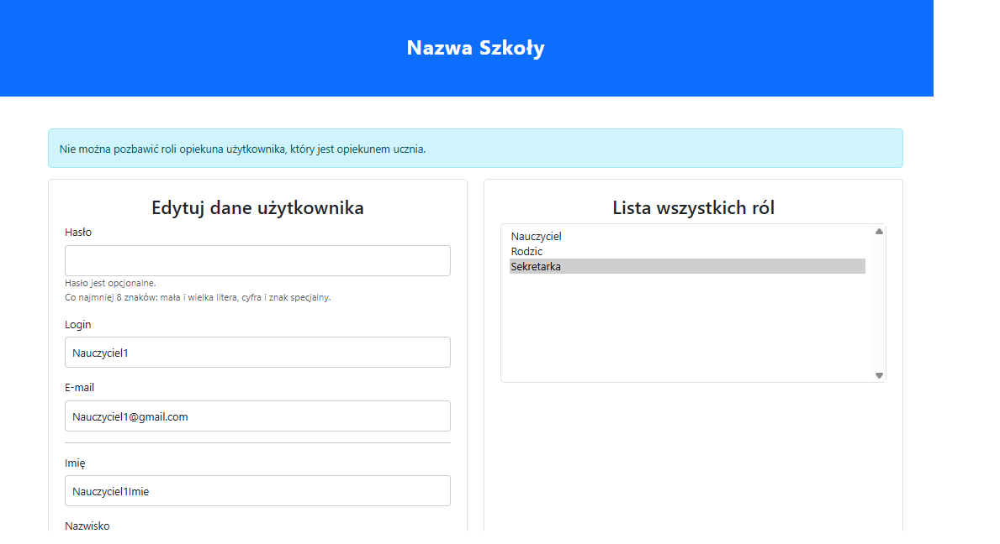
*Ochrona powiązań: nie można odebrać roli Rodzic opiekunowi ucznia. Formularz zostaje na ekranie, a zaznaczenie ról jest zachowane.*
